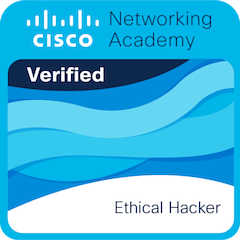
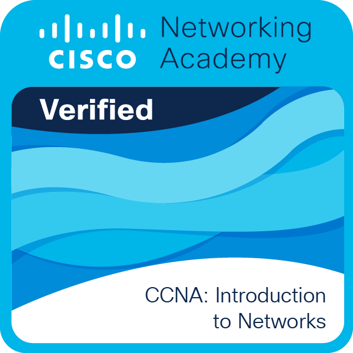
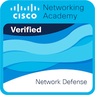

<!-- ===================== PROFILE HEADER ===================== -->

<h1 align="center">Ayush Jakhmola</h1>
<h3 align="center">Offensive Security Researcher | Penetration Tester</h3>

<strong>Web • Network • Cloud Security • Wi-Fi • AI</strong>

  
  
  

---

## Profile

Offensive Security Researcher and Penetration Tester focused on understanding real-world vulnerabilities, assessing security controls, and improving technical troubleshooting skills.

- Active on **HackerOne** since March 2026
- Learning and practicing on **TryHackMe** (since November 2025), Hack The Box, and PortSwigger Web Security Academy
- Focus areas: web application security, network penetration testing, Active Directory, cloud security, Wi-Fi security, and AI/LLM security
- Interested in vulnerability research, bug bounty hunting, security automation, and clear technical reporting

## Core Expertise

  
  
  
  
  

## Active Directory & Enterprise Network Security

Focused on learning and lab-based assessment of Windows domain environments:

- **Active Directory enumeration:** domain structure, users, groups, computers, and permissions
- **DNS and domain discovery:** name resolution, DNS records, and domain controller discovery
- **Kerberos:** authentication flows, tickets, SPNs, and common configuration issues
- **SMB and LDAP:** service reachability, directory queries, share access, and permissions
- **BloodHound and Impacket:** analyzing relationships and security configurations in authorized labs
- **Windows security:** group membership, access controls, event logs, and least-privilege review
- **Network defense:** firewall rules, exposed services, segmentation, logging, and incident triage

### Network Troubleshooting Reference

| Issue | Check | Tools / Commands |
|---|---|---|
| Domain join failure | DNS, domain controller discovery, system time | `ipconfig /all`, `nslookup`, `nltest` |
| Kerberos / login issue | Clock skew, account state, ticket cache | `klist`, Event Viewer |
| SMB access issue | Reachability, share and NTFS permissions | `Test-NetConnection`, `smbclient` |
| LDAP connection failure | DNS, port reachability, TLS / bind settings | `ldapsearch`, `nc` |
| Host / service unreachable | IP settings, routing, firewall, service state | `ping`, `traceroute`, `Nmap` |
| Unexpected open port | Listening process and exposure | `ss -lntup`, `Nmap` |
| Linux service failure | Service state and logs | `systemctl`, `journalctl` |
| Intermittent connectivity | Latency, packet loss, DNS, retransmissions | `ping`, Wireshark |

## Certifications & Learning

### In Progress

  
  

### Certifications / Courses
- Cisco Ethical Hacker
- CCNA: Introduction to Networks
- Cisco Network Defense
- AWS Cloud Practitioner Essentials

### Course Badges

  
  
  
  
  

Click any badge to open the full-size image. All badge images are stored in the [Images folder](./Images/).

## Operating Systems

  

- **Zorin Linux** — Primary OS
- **Kali Linux** — Penetration testing
- **Ubuntu Server** — Vulnerable lab and service testing
- **Windows 11** — Testing and troubleshooting

## Programming & Scripting

  

- **Languages:** C, C++, Python, Java
- **Scripting:** Bash, PowerShell
- **Web:** HTML5, CSS3
- **Database:** MySQL

## Security Tools & Offensive Utilities

### Web & API

  
  
  
  
  
  
  
  

### Network Reconnaissance

  
  
  
  
  
  
  

### Active Directory / Windows

  
  
  
  

### Exploitation & Password Auditing

  
  
  
  
  
  

### Wireless Security

  
  
  

## Featured Projects

- [LLM Vulnerability Scanner](https://github.com/ayusjakhmola25/LLM-Vulnerability-Scannner) — LLM application security testing and vulnerability analysis.
- [Password Cracking Analyzer Tool](https://github.com/ayusjakhmola25/Password-Cracking-Analyzer-Tool) — password strength analysis and auditing concepts.

## Learning Platforms

  
  
  

## GitHub Stats

  
  

  

  

  

---

Security testing should be performed only on systems you own or are explicitly authorized to assess.

